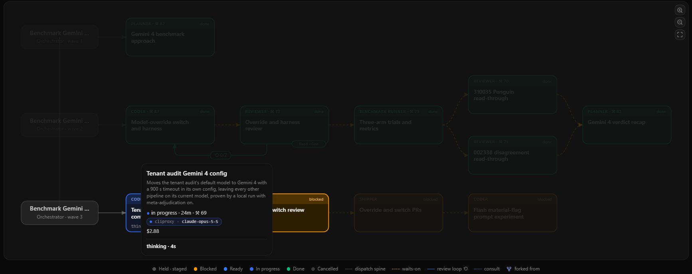
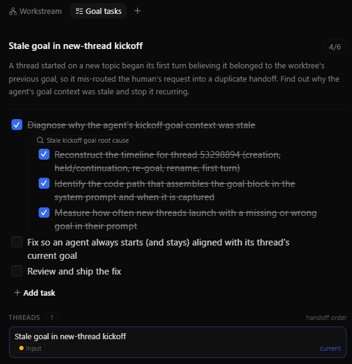
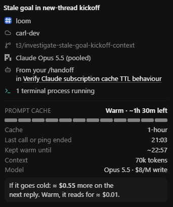
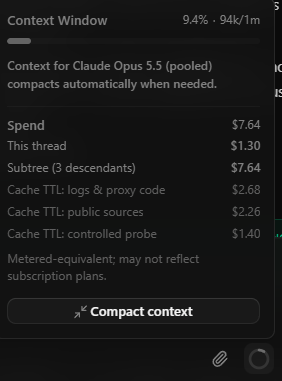
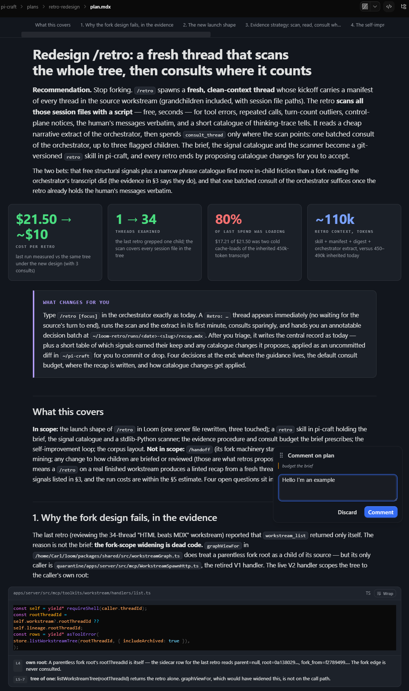

# Loom

Loom is a fork of [T3 Code](https://github.com/pingdotgg/t3code), the open-source "agent harness control surface". It keeps T3 Code's server, web app and agent-driving core, and adds what you need once agents are doing real work unattended: a clear view of what every agent is doing and what it costs, a control plane that notices when one goes wrong, and cheap ways to step in.

Loom drives agents through [pi](https://github.com/badlogic/pi-mono). Codex, Claude, Cursor and the other vendors' models are reached through pi rather than their own CLIs.



<sub>A workstream across three waves of orchestration: planner, coder, reviewer and benchmark-runner threads wired by dependencies and a review loop; a coder in progress, a shipper blocked behind it, and the live thread's model, cost and state on hover.</sub>

## Why fork?

I love pi, but I wanted to multi-task on an always-on remote server, and doing that in a terminal was a pain in the arse. SSH'ing in from different machines gave me different interfaces with their own quirks, and keeping track of what I was working on became a chore. I needed a web interface where I could see the threads I had running, jump between them and pick up where I was. I tried a handful of platforms and landed on T3 Code: it has the ergonomics, the attention to detail, and it's snappy.

In 2025 agents were getting there, but they weren't mature, and they still aren't. They loop, run commands that never return, drift from instructions, go quiet without reporting, or burn a quota. Loom assumes this _will_ happen: make it obvious what is going on, detect failures deterministically, fix the ones a nudge can fix, and hand the rest back to the orchestrating agent (or you) for steering instead of halting silently.

## What Loom adds

### See what agents are doing, how they plan to work, and what it costs

- **Workstreams.** Delegated work is a graph of real, durable threads, not in-turn subagents. Each child has its own transcript, role and model. You _can_ open it, read it and talk to it, or ignore it altogether.
- **Goals and task trees.** Every piece of work has a goal, a north star, so it's always clear what you're working towards. Sure, it keeps the agents aligned, but it's really for you: jump into any thread and you can immediately see what the goal is and how far along it is.
- **Plans, recaps and explainers reviewed in-app.** You're not going to read a wall of markdown, and HTML plans look great until the agent hands you 18k lines of it. Agents get the building blocks for compact, grokable documents that won't make your eyes glaze over, and you annotate and decide on them in place.
- **Diffs per thread.** Diffs are viewed per sub-thread, so you know which agent wrote what.
- **Cost.** Quota windows against your burn rate, spend per thread and per workstream, and whether the prompt cache is warm (cheap) or cold (expensive) before you reply.

<table>
  <tr>
    <td valign="top"></td>
    <td valign="top"></td>
    <td valign="top"></td>
  </tr>
  <tr>
    <td valign="top"><sub>The goal and its task tree: 4 of 6 done, and which thread is on it.</sub></td>
    <td valign="top"><sub>Prompt cache: warm for another 1h 30m, and what the next reply costs now versus after it goes cold.</sub></td>
    <td valign="top"><sub>Context window and spend: this thread, its three descendants, and each one's share.</sub></td>
  </tr>
</table>



<sub>A plan rendered in-app: recommendation first, the numbers that justify it, what changes for you, then the evidence with annotated code. Comment on any line and decide in place.</sub>

### Catch things going wrong, and intervene

- **Nothing halts silently.** Every active thread is continuously classified: dead, stalled, spinning (busy, producing nothing) or stuck in a slow tool call. A stall gets one nudge, then escalates to its parent. A child that goes quiet without reporting gets a report synthesised from its last message, so its parent is never left waiting.
- **Bounded loops.** Review gates run a coder and reviewer for a capped number of rounds before yielding; deadlocks in the dependency graph are flagged rather than waited on.
- **Quota failover.** When a model's quota runs out, the thread _can_ move to a healthy model from another vendor and carry on.
- **Inter-agent comms without context pollution.** Work is split up, so agents need to talk to each other. A thread consults another through an ephemeral fork, gets its answer, and only reaches the human if it's truly ambiguous. Threads can launch new threads, hand off work, and send instructions to each other.
- **A human when it matters.** A thread that needs you raises a flag and holds; the inbox shows what's waiting on you and why. Open any thread and talk to it directly, or steer it through its parent.

## How it differs from T3 Code

- **Pi first.** The other providers can be switched back on, but they won't get the Loom features, which reach the agent through a pi extension.
- **Web first.** The desktop and mobile apps are barely touched (for now); Loom's features live in the web client.
- **Personal fork.** One maintainer, and most commits are written by agents running inside Loom. Expect sharp edges.

## A short history

Loom and T3 Code have grown alongside each other, and the line between them has moved, they're actually now much closer to each other than when I started this project.

- **Pi.** Loom drove agents through pi long before upstream added a pi driver, and still bundles its own patched pi.
- **Usage meters.** I needed a usage meter that worked across multiple subscriptions. Upstream has one now; Loom keeps its own because quota-versus-burn-rate is the view that matters when agents run unattended.
- **Subagents.** Upstream has since added in-turn subagents. Loom took a different path: delegated work is a workstream of durable threads you can inspect and steer, not a call inside a turn.
- **Question card.** Just let me pick the option from a list. Now replaced by T3 Code's version.
- **Cache warmth.** Knowing whether the cache is warm or cold before you reply. Still Loom's.
- **DB and WebSockets.** Oh dear god this was buggy as fuck, although I think T3 Code has patched most of the issues now.

## Running it

Prerequisites: Node 24, git ≥ 2.41, and the [`vp`](https://viteplus.dev/guide/) CLI.

```bash
git clone https://github.com/QuinRiva/loom
cd loom
vp i
pnpm build
pnpm cockpit   # serves on port 13900 with state in ~/.t3/cockpit
```

For development, `vp run dev` starts the server and web app against a worktree-local `.t3`. See [docs/operations/development.md](./docs/operations/development.md).

## Staying in sync with upstream

Loom pulls from upstream regularly. Every Loom change to an upstream file is marked `// loom:` (the ship gate enforces it); larger additions live in `*.loom.ts` modules, `apps/server/src/loom/` and `apps/web/src/loom/`; database migrations run in a separate `1001+` ledger so upstream's stay intact. The doctrine is in [docs/upstream-sync/](./docs/upstream-sync/).

## Documentation

T3 Code's [user docs](./docs/user/) still apply to everything Loom inherits. Loom's own design is in [docs/design/](./docs/design/), [docs/architecture/](./docs/architecture/) and [docs/operations/](./docs/operations/). Building from source? Start at [docs/internals/overview.md](./docs/internals/overview.md).

## Contributing

Loom is not accepting contributions. Issues are welcome. Upstream feature requests belong in [T3 Code's discussions](https://github.com/pingdotgg/t3code/discussions/categories/ideas).

MIT licensed, as is T3 Code.
